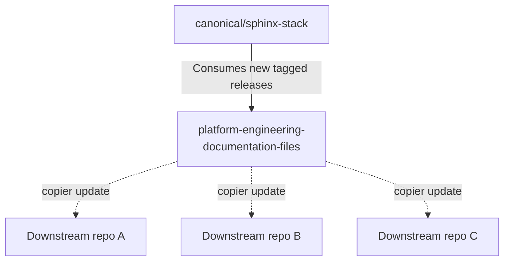

# Update lifecycle

This solution uses [`canonical/sphinx-stack`](https://github.com/canonical/sphinx-stack)
as a source of truth for the majority of its files. When the Sphinx Stack releases a new
update, this solution must ensure that the update propagates downstream while
gatekeeping breaking changes.

The downstream repositories using this solution apply the standard structure and theming of the Canonical Sphinx Stack.
The current `sphinx-stack` version used by this solution
is pinned in [`template/.sphinx-stack-version`](../../template/.sphinx-stack-version).
Upon a new tagged release of `sphinx-stack`, an automated scheduled workflow updates any
affected files used in this solution, bumping `.sphinx-stack-version` in the process. 

## How upstream files are synced

The `sphinx-stack-sync` workflow downloads the complete source snapshot of the new
`sphinx-stack` release and runs [`scripts/sync_sphinx_stack.py`](../../scripts/sync_sphinx_stack.py).
The workflow doesn't list any upstream file names. Instead, every file in the snapshot is
classified by the first matching rule in the declarative ownership policy,
[`scripts/sphinx_stack_sync_policy.json`](../../scripts/sphinx_stack_sync_policy.json):

| Action | Behavior |
|--------|----------|
| `mirror` | Upstream owns the file. It's copied verbatim into `template/` and tracked. |
| `merge` | Upstream changes are merged with local content. For `docs/requirements.txt`, only packages not yet listed locally are appended; local version pins are left unchanged. |
| `preserve` | This repository owns the file. It's never modified. |
| `report` | The file is listed for manual review when it changes upstream, for example `docs/conf.py`. |
| `ignore` | Upstream-only content that isn't part of the template. |

Files that match no rule are reported for review. To change how a path is handled,
edit the policy file; the workflow doesn't need to change.

Mirrored files are recorded, with the hash of the content last synced, in
`scripts/sphinx_stack_sync_state.json` (created by the first sync). This
lets the sync:

- Update a mirrored file only if it wasn't modified locally since the last sync.
- Delete a mirrored file that was removed upstream, but only if the local copy still matches
  the content last synced.
- Report a conflict, instead of overwriting or deleting, when a mirrored file was modified
  locally. Resolve the conflict by either adopting the upstream content or changing the
  file's rule to `preserve`.

If the state file doesn't exist, it's bootstrapped from the snapshot of the release
recorded in `.sphinx-stack-version`.

The script's report becomes the body of the sync pull request, listing the mirrored,
merged, and removed files and anything that needs attention.

A downstream repository manages its updates using `copier update` to pull in the changes.
This solution contains a callable workflow to automatically detect and propagate the update.

## Three-way merge and conflict resolution

`copier update` re-renders the template at the new version and re-applies the
downstream repository's own changes on top as a three-way merge. If a downstream
repository has modified a managed file and the template changed the same region,
the merge can conflict.

Copier does not resolve such conflicts automatically. It writes both versions into
the affected file between `<<<<<<<` and `>>>>>>>` conflict markers and leaves them
inline for a human to review and resolve before the update is merged. Until the
markers are resolved, a managed file that is executed at build time (such as
`docs/conf.py`) is invalid, meaning the documentation
build will fail until a human corrects the issues.

> See also:
  [How to update a downstream repository](../how-to/update-downstream-repo.md)

