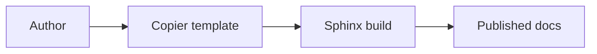
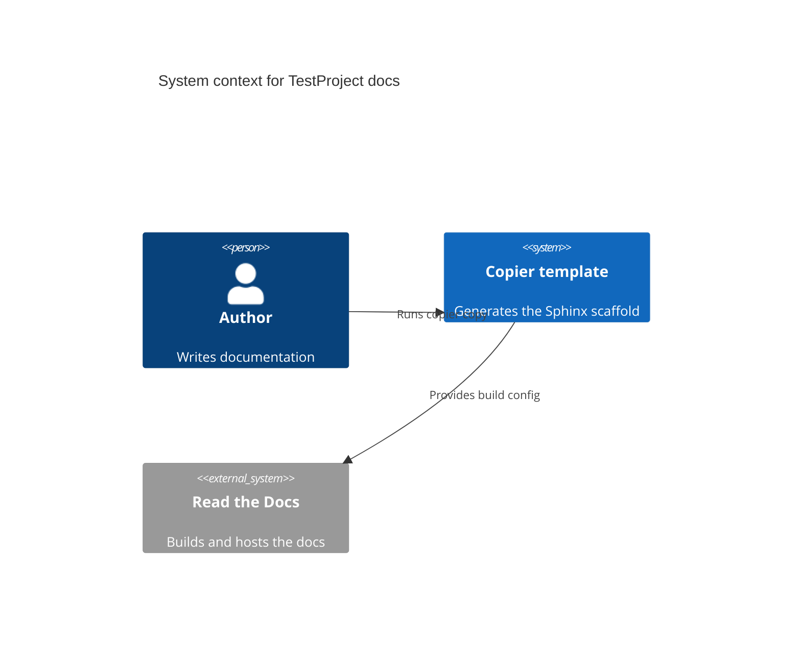

---
myst:
  html_meta:
    "description lang=en": "Test page exercising bundled Sphinx extensions."
relatedlinks: "[Juju](https://juju.is/)"
---

# Extensions

This page exercises the directives and roles provided by the extensions bundled
in the template's `requirements.txt`, so that a broken, removed, or
misconfigured extension fails the build.

## sphinxcontrib-mermaid

The following diagram exercises the `sphinxcontrib-mermaid` extension. It is
written as a plain ` ```mermaid ` fence, which `myst_fence_as_directive`
promotes to the `{mermaid}` directive:



A second diagram uses Mermaid's `C4Context` syntax to confirm that the bundled
Mermaid version renders C4 model diagrams:



## sphinx-design

````{grid} 1 1 2 2

```{grid-item-card} Card title
Card body content rendered by `sphinx-design`.
```

```{grid-item-card} Second card
More card content.
```

````

```{dropdown} Expandable section
Hidden content revealed by the `dropdown` directive.
```

Inline badge: {bdg-primary}`sphinx-design badge`.

## sphinx-tabs

````{tabs}

```{tab} First tab
Content of the first tab.
```

```{tab} Second tab
Content of the second tab.
```

````

## sphinx-terminal

```{terminal}
make html

build succeeded.
```

## sphinx-config-options

```{config:option} test_option
:shortdesc: An example configuration option.
:type: string
:default: none
Longer description of the configuration option.
```

## sphinx-youtube-links

```{youtube} https://www.youtube.com/watch?v=dQw4w9WgXcQ
:title: Example video
```

## sphinx-roles

A custom role from `sphinx-roles`: {spellexception}`Kubeflow`.

## intersphinx

A cross-reference into the Juju documentation via `intersphinx_mapping`:
{external+juju:ref}`action`.
