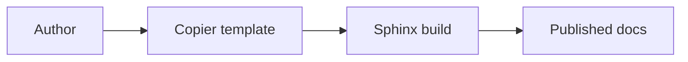
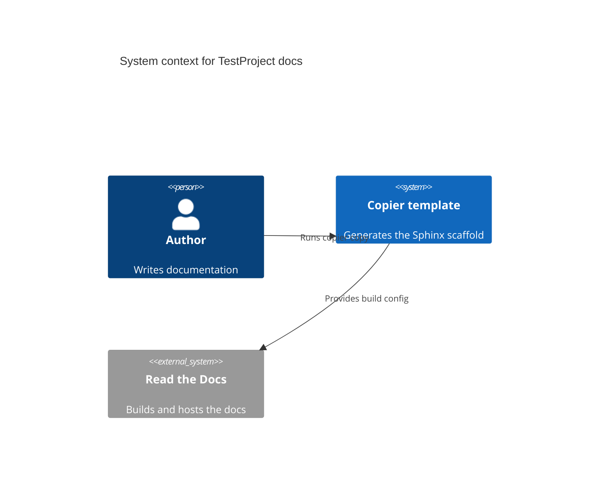

---
myst:
  html_meta:
    "description lang=en": "Test HTML metadata description."
---

(reference_index)=

# Reference

This is a test page used to validate that the generated Sphinx documentation
scaffold builds successfully without warnings or errors.

## Mermaid diagram

The following diagram exercises the `sphinxcontrib-mermaid` extension. It is
written as a plain ` ```mermaid ` fence, which `myst_fence_as_directive`
promotes to the `{mermaid}` directive:



A second diagram uses Mermaid's `C4Context` syntax to confirm that the bundled
Mermaid version renders C4 model diagrams:

